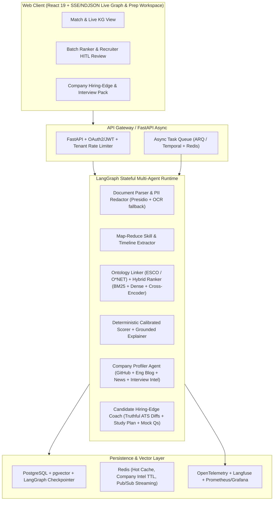
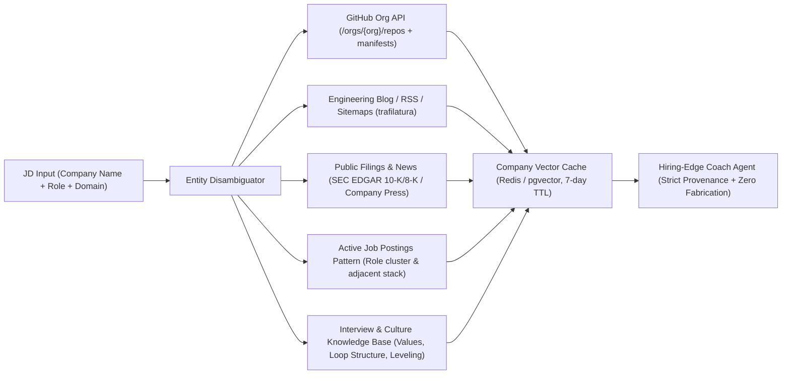

# Matchwright — Advanced Production Live-System Build Plan (with Company Hiring-Edge Intelligence)

This blueprint transforms Matchwright from a single-node DoD prototype into an **enterprise-grade, real-time, live Talent Matching & Candidate Intelligence Platform**. Beyond scoring a resume against a job description, it introduces a dedicated **Company-Specific Intelligence & Hiring-Edge Module** designed to concretely maximize a candidate's chances of landing an offer at that specific company.

---

## 1. Deep Research: Why Basic Resume Matchers Fail & What State-of-the-Art Requires

| Layer | Current Baseline (`v1`) | Production Weakness | Advanced Live-System Upgrade (`v2`) |
|---|---|---|---|
| **Agent Runtime** | `langchain-classic` linear `AgentExecutor` (text ReAct) | No persistent checkpoints; small models loop on Observations; no parallel tool execution or Human-in-the-Loop (HITL) interrupts | **LangGraph `StateGraph`** with typed state, `AsyncPostgresSaver` durability, parallel fan-out nodes, conditional retries, and HITL `interrupt_before` checkpoints |
| **Skill Taxonomy** | Static `config/aliases.yaml` (~60 entries) + lazy keyword scan | Misses emerging tools, regional phrasing, and parent-child hierarchies (e.g., `Next.js` $\rightarrow$ `React` $\rightarrow$ `Frontend`) | **ESCO v1.2 + O*NET 29+ Skill Ontology Graph** (in Postgres/Neo4j) + automated alias mining + **Skill Recency & Depth Weighting** |
| **Retrieval & Matching** | Whole-document `bge-small` cosine + exact/group credit | Bi-encoders compress long docs into one vector, losing fine-grained context (e.g., "managed Python devs" vs "wrote Python") | **Two-Stage Hybrid Retrieval + Cross-Encoder Reranking**: BM25/SPLADE lexical + Dense Vector (`BAAI/bge-m3`) fused via **Reciprocal Rank Fusion (RRF)** $\rightarrow$ Cross-Encoder (`BAAI/bge-reranker-v2-m3`) |
| **Structured Extraction** | Chunked JSON-schema prompt (`max_chunks=6`) | Drops skills in chunks `> 6`; treats 2016 school project equal to 2025 production role | **Full-Document Map-Reduce Extraction** with grammar-constrained decoding (`vLLM` / `Ollama` / `SGLang`), timeline-aware recency decay, and proficiency inference |
| **Calibration & Compliance** | Hand-tuned weights (`0.45 / 0.15 / 0.15 / 0.15 / 0.10`) | Uncalibrated raw percentages; lacks formal EU AI Act high-risk audit artifacts | **Isotonic/Platt calibration** on human hiring labels + **EU AI Act Annex III Point 4** compliance (6-month immutable audit logs, Article 14 human oversight, Article 10 proxy checks) |
| **Candidate Value ("Boost Chances")** | Score + 3 static bullets + missing skill list | Tells the user *why they failed* or *what is missing*, without helping them **win the interview at that exact company** | **Company Intelligence & Hiring-Edge Engine**: Automated research of the target company's GitHub, engineering blog, interview loops, values, truthful ATS resume rewrites, and targeted study/outreach pack |

---

## 2. System Architecture (Production Live System)



---

## 3. Core Technical Deep-Dives

### 3.1 LangGraph Durable Multi-Agent Orchestration
Replace `AgentExecutor` with an explicit typed `StateGraph`:
- **Why:** ReAct text parsing fails unpredictably on smaller models and cannot pause/resume or run branches in parallel.
- **Topology:**
  1. `ingest_and_redact`: Extracts text (with optional PaddleOCR/Tesseract fallback for scanned PDFs), redacts PII via **Microsoft Presidio** (`PERSON`, `EMAIL`, `PHONE_NUMBER`, `LOCATION`), and records SHA-256 audit hashes.
  2. **Parallel Fan-Out:** Simultaneously runs `extract_resume_graph`, `extract_jd_graph`, and (if `company_name` is present) `research_company_node`.
  3. `normalize_and_link`: Links extracted spans to canonical ESCO/O*NET URIs with parent/child distances.
  4. `hybrid_score`: Computes deterministic skill coverage, **recency-weighted experience** (e.g., skills used in the last 2 years receive `1.0x`, 3–5 years `0.85x`, >5 years `0.65x`), cross-encoder contextual relevance, and mandatory knockout rules.
  5. **Conditional HITL Edge:** In recruiter mode, borderline candidates (`score` in `55–75` or `confidence == "low"`) trigger `interrupt_before=["human_review"]` backed by `AsyncPostgresSaver`.
  6. `explain_and_coach`: Emits grounded justifications + launches the **Company Hiring-Edge** generator.

### 3.2 Two-Stage Hybrid Retrieval & Cross-Encoder Reranking (For `/v1/rank` & Talent Pools)
When ranking 20–10,000 candidates against a JD:
1. **Stage 1 (Recall — `< 50ms`):** Run **BM25 / sparse SPLADE** (catches exact acronyms like `k8s`, `ICD-9`, `SAP ABAP`) alongside **Dense Embeddings (`BAAI/bge-m3`)** stored in **Qdrant** or **pgvector**, fused via **Reciprocal Rank Fusion (RRF)**:
   $$\text{RRF}(d) = \frac{1}{60 + r_{\text{bm25}}(d)} + \frac{1}{60 + r_{\text{dense}}(d)}$$
2. **Stage 2 (Precision — Top 50):** Pass `(JD requirement chunk, Candidate experience chunk)` pairs through a Cross-Encoder (`BAAI/bge-reranker-v2-m3`) so full cross-attention verifies *context* (distinguishing someone who *built* Kafka pipelines from someone who *coordinated with* a Kafka team).
3. **Stage 3 (Deterministic Breakdown):** Feed verified skill links into `score_match()` so every ranked candidate still receives an auditable 0–100 breakdown and requirement ledger.

### 3.3 EU AI Act Compliance by Design (Annex III Point 4)
Under **Regulation (EU) 2024/1689** (amended by Digital Omnibus 2026/1744, high-risk HR obligations enforcing Dec 2, 2027), AI used to rank or filter resumes is **High-Risk**:
- **Article 12 (Logging):** Immutable append-only `audit_events` table storing `input_hashes`, `model_version`, `ontology_version`, `weights`, `sub_scores`, `trace_id`, retained $\ge 6$ months.
- **Article 14 (Human Oversight):** Explicit `decision_support_only: true` banner, no auto-reject API status, override reason logging (`recruiter_override_reason`).
- **Article 10 (Bias & Proxy Mitigation):** Automated CI gate running `bias_check.py` (name/pronoun/university/zip-code counterfactual swaps $\Delta \le 2$) plus adverse impact ratio monitoring across cohorts.
- **Article 50 (Transparency):** Clear disclosure when AI evaluates a candidate + requirement-level evidence citations.

---

## 4. Additional Section: Company-Specific Resources & Hiring-Edge Module ("Increase Candidate Chances")

When a user matches their resume against a JD from a specific company (e.g., *Stripe*, *Databricks*, *Netflix*, *V2X Inc*, or a Remotive startup), knowing they scored `72/100` is only half the battle. To actually **increase their chance of getting shortlisted and passing the interview**, Matchwright v2 adds a **Company Hiring-Edge Engine** (`/v1/company/intel` and `/v1/match/coach`).

### 4.1 What Data Sources It Researches Automatically



1. **Public GitHub Organization Mining (`GitHub REST/GraphQL API`)**:
   - Inspects top active repositories and root manifests (`package.json`, `pyproject.toml`, `go.mod`, `Cargo.toml`, `pom.xml`, `Dockerfile`, `.github/workflows/*.yml`).
   - Reveals *actual* production tools not always listed in the HR-written JD (e.g., `"JD says Python + Cloud, but org repos heavily use FastAPI, Pydantic v2, Terraform, and OpenTelemetry"`).
   - Identifies active open-source projects or good-first-issues the candidate can explore or reference in interviews.
2. **Engineering Blog & Architecture Scraper (`trafilatura` + RSS/Sitemap)**:
   - Fetches recent engineering posts (e.g., migrations, scaling bottlenecks, latency budgets, ML platform architecture).
   - Extracts concrete architectural talking points so the candidate can ask informed questions and frame system design answers in the company's own vocabulary.
3. **Company Business & Product Context (News / SEC EDGAR / Official About)**:
   - Summarizes revenue drivers, recent product launches, and current strategic priorities (e.g., AI copilots, cost optimization, international compliance) to nail *"Why this company?"* prompts.
4. **Role-Specific Interview Loop Blueprint**:
   - Maps company size + role family (e.g., Big Tech vs Series-B startup vs Defense/Enterprise like V2X) to expected interview rounds (ATS screen → Hiring Manager → Coding/DSA or Practical Take-Home → System Design → Values/Behavioral).

### 4.2 Five Concrete Deliverables Returned to the Candidate

Every item returned by the Hiring-Edge Engine is wrapped in strict grounding rules:

1. **Truthful ATS Resume Tailoring Diffs (Zero Fabrication Guarantee)**:
   - Compares missing/weak JD keywords against the candidate's *existing* projects and bullets.
   - Suggests **terminology alignment** (e.g., if the resume says *"built REST endpoints"* and the JD checks for *"API microservices"*, or *"Postgres queries"* $\rightarrow$ *"PostgreSQL / SQL optimization"*).
   - Suggests STAR-formatted bullet upgrades using placeholders `[X% latency reduction / N req/s]` where the candidate must fill in their real metric — **strictly refusing to invent fake skills or fake numbers**.
2. **Ranked Gap-Closure Micro-Roadmap (By ROI on Score & Interview Probability)**:
   - Ranks missing required/knockout skills by impact on the match score (e.g., closing a missing `mandatory` skill lifts the knockout cap from `60` to `85+`).
   - Attaches curated, free, high-signal resources per skill (official quickstarts, interactive labs, 1-weekend portfolio micro-project ideas tailored to the company's domain).
3. **Company-Tailored Interview Prep Pack**:
   - **3–5 Technical / System Design Prompts** grounded in the JD + company's real tech stack/blog (with key evaluation criteria the interviewer looks for).
   - **3 Behavioral Prompts** mapped to the company's stated core values/leadership principles, pre-paired with which experience from *this* candidate's resume best fits each prompt.
   - **3 Smart Questions to Ask the Interviewer** referencing recent company engineering themes or product launches.
4. **Targeted Outreach & Referral Playbook**:
   - Drafts concise, non-spammy cold-outreach / referral notes to recruiters or hiring engineers citing specific overlap between the candidate's background and the company's current engineering focus.
5. **Provenance & Confidence Ledger**:
   - Every external company insight carries `{source_url, source_type, fetched_at, verified: true|inferred}` so the candidate knows what came directly from official sources vs general role patterns.

### 4.3 New Pydantic Schemas & API Endpoints

```python
class CompanyInsight(BaseModel):
    company_name: str
    domain: str | None = None
    verified_stack: list[str] = Field(default_factory=list)       # from GitHub/blog/JD
    architecture_themes: list[str] = Field(default_factory=list)  # from engineering blog
    business_focus: list[str] = Field(default_factory=list)
    interview_loop_stages: list[str] = Field(default_factory=list)
    citations: list[dict] = Field(default_factory=list)           # {title, url, source_type, fetched_at}
    cached_at: str

class ResumeTailoringTip(BaseModel):
    target_jd_skill: str
    current_resume_evidence: str
    suggested_rewrite: str
    truthfulness_note: str  # explains what must stay verified by candidate

class GapStudyItem(BaseModel):
    skill: str
    score_impact_estimate: str   # e.g. "+14 pts (removes knockout cap)"
    priority: Literal["critical", "high", "medium"]
    study_plan_48h: str
    project_idea: str
    resources: list[dict]        # {title, url, kind: "docs"|"course"|"repo"}

class HiringEdgePack(BaseModel):
    company_intel: CompanyInsight
    tailoring_tips: list[ResumeTailoringTip]
    gap_roadmap: list[GapStudyItem]
    technical_questions: list[dict]
    behavioral_prompts: list[dict]
    questions_to_ask: list[str]
    outreach_template: str
```

New endpoints:
- `POST /v1/company/intel` — fetches/caches structured `CompanyInsight` (7-day Redis/Postgres TTL, respects `robots.txt` & API rate limits).
- `POST /v1/match/coach` — takes `match_id` (or resume + JD + optional `company_name`) and streams/returns `HiringEdgePack`.

---

## 5. Complete Phased Build Plan (v1 $\rightarrow$ v2 Live System)

| Phase | Scope | Key Deliverables | Acceptance Gate |
|---|---|---|---|
| **Phase A: Durable Runtime & Postgres** | Replace SQLite + `AgentExecutor` with Postgres (`pgvector`), Redis cache, and LangGraph `StateGraph` + `AsyncPostgresSaver` | Typed `MatchGraphState`, parallel resume/JD extraction, HITL interrupt hook | All 24 existing tests pass + resume-from-checkpoint integration test |
| **Phase B: Ontology & Hybrid Retrieval** | Integrate ESCO v1.2 + O*NET skill graph, `BAAI/bge-m3` dense + BM25 RRF + `bge-reranker-v2-m3`, and recency-weighted experience scoring | `app/taxonomy/graph.py`, `app/retrieval/hybrid.py` | Beat `v1` Spearman $\rho$ and NDCG@5 on 100+ human-labeled `eval/gold_pairs.csv` |
| **Phase C: Full-Doc Map-Reduce & Compliance** | Remove `max_chunks=6` truncation via async map-reduce extraction, add Microsoft Presidio PII scrubbing + Tesseract/PaddleOCR fallback, EU AI Act immutable audit log | `audit_events` table, Presidio pipeline, OCR guard | Counterfactual fairness $\Delta \le 2$, scanned PDFs OCR'd cleanly, zero PII in LLM logs |
| **Phase D: Company Intelligence Engine** | Build `CompanyProfiler` connectors (GitHub Org API, RSS/Sitemap blog scraper with `trafilatura`, SEC/news search, Redis 7-day cache) | `POST /v1/company/intel`, cited `CompanyInsight` JSON | Given 10 real companies, returns verified stack + $\ge 2$ real source URLs in `< 8s` (cached `< 100ms`) |
| **Phase E: Hiring-Edge Coach & Truthful Tailoring** | Build `HiringEdgeCoach` node + UI tab ("Company Prep & Boost Chances") with resume diff suggestions, gap study roadmap, and mock interview questions | `POST /v1/match/coach`, React `HiringEdgePanel.tsx` | Zero fabricated skills (verified by grounding check against candidate profile) |
| **Phase F: Production Hardening & Observability** | OpenTelemetry + Langfuse traces, ARQ/Celery workers for `/v1/rank` batches (100+ resumes), Canary evals in CI, multi-stage K8s/Render/Fly deploy | Grafana dashboards, p95 `< 3s` (cached) / `< 12s` (cold), automated rollback | Load test (50 concurrent matches, 0 5xx errors) + security/prompt-injection red-team pass |

---

## 6. Guardrails for the Candidate-Boost Module (Non-Negotiable Rules)

1. **Never fabricate experience:** Rewrites may *only* reframe verified candidate experience in the JD's terminology; missing skills go exclusively into the **Gap-Closure Roadmap**, never into suggested resume bullets.
2. **Never scrape behind logins or bypass anti-bot gates:** Use only official public APIs (GitHub API, RSS/sitemaps, SEC EDGAR, Remotive/Adzuna) with polite rate limits, `User-Agent` headers, and disk/Redis caching.
3. **Always cite provenance:** Every company tech-stack claim or blog insight must include its source URL and retrieval timestamp; if a company is private/obscure with sparse public data, fall back gracefully to role/industry-level interview guidance marked `"inferred_from_jd"`.
